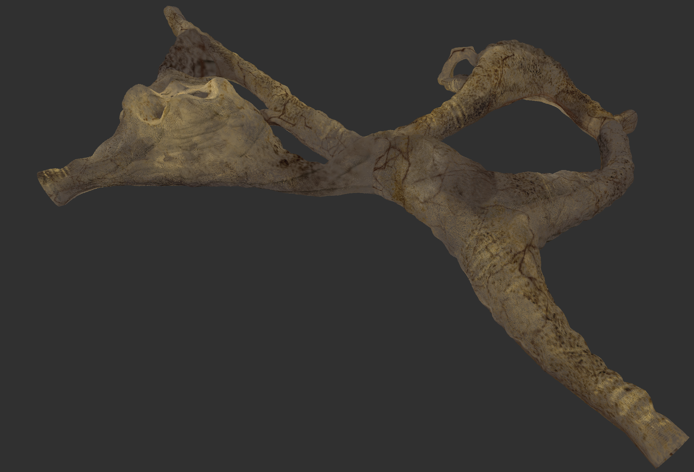
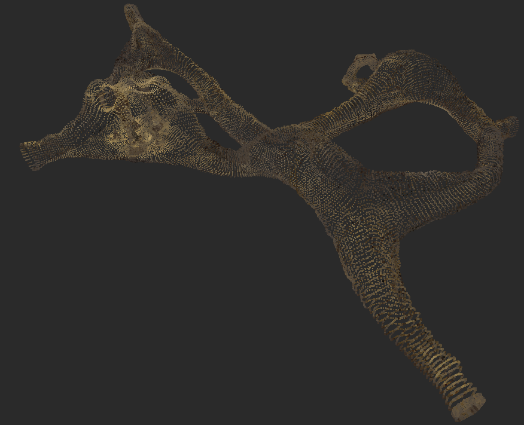
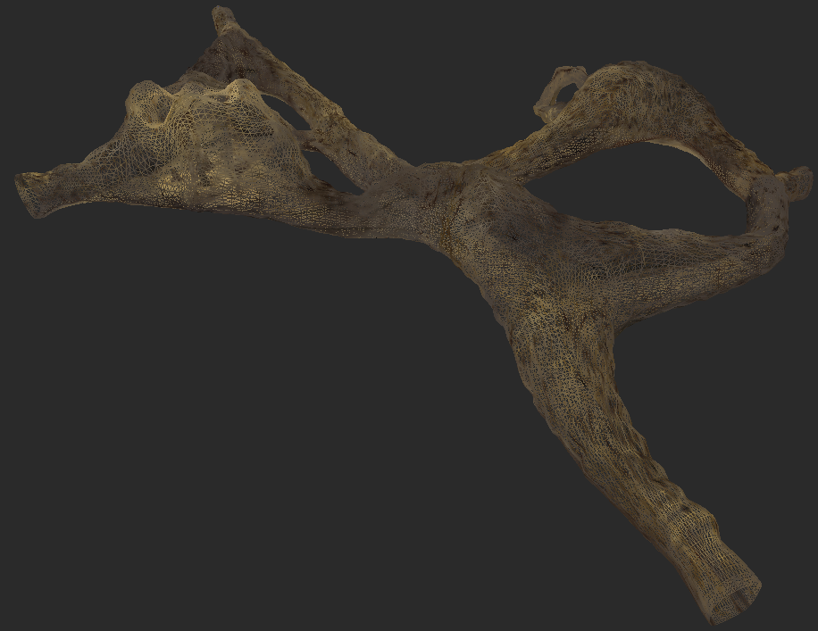
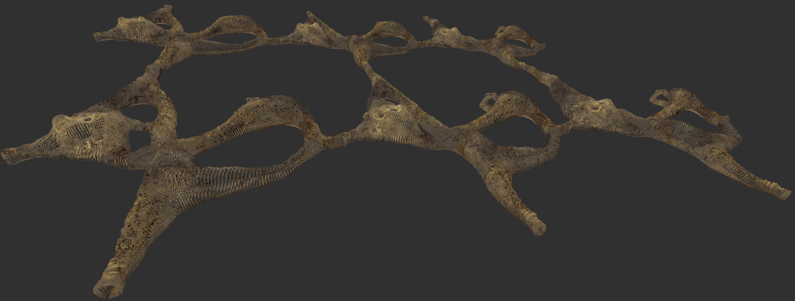
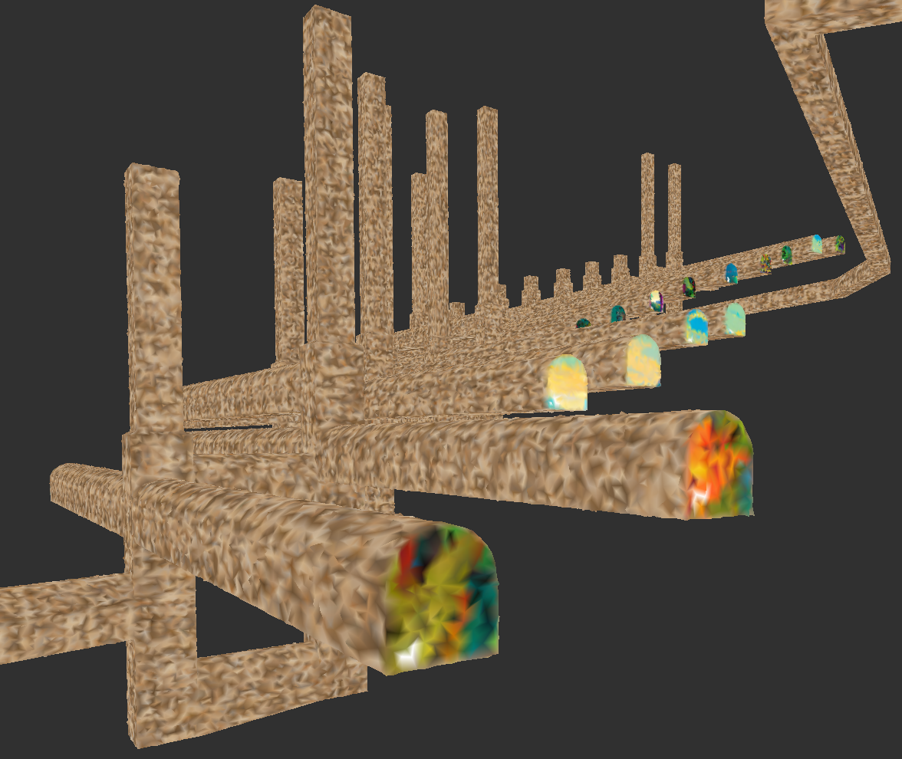

# UD-Caves

UD-Caves generates synthetic cave and tunnel datasets as 2-manifold triangle
meshes and point clouds. Its geometric and topological parameters make the
datasets useful for developing, evaluating, and calibrating 3D algorithms.

This is the maintained repository:
[github.com/VCityTeam/UD-Caves](https://github.com/VCityTeam/UD-Caves).

## Origin and attribution

UD-Caves is adapted from
[VCityTeam/TT-Ribs](https://github.com/VCityTeam/TT-Ribs). The source code,
Blender models, documentation, and illustrations were migrated here, with the
project layout normalized to lowercase directory names (`src`, `docs`, and
`blender`). The source repository remains available as the historical record.

The original Ribs name refers to the Lyon fish bones, which inspired the tunnel
part of the project. The image-heavy background documentation remains
[available in the TT-Ribs source repository](https://github.com/VCityTeam/TT-Ribs/tree/master/Doc/Lyon_Fish_Bones).

## What it produces

The generators use the [Blender Python API](https://docs.blender.org/api/current/)
to create:

- a regular, human-made tunnel system;
- a less regular cave system;
- a triangle mesh and a point cloud for each generated system;
- OBJ and [PLY](https://paulbourke.net/dataformats/ply/) exports.

PLY is supported by tools such as [CloudCompare](https://www.cloudcompare.org/)
and [MeshLab](https://www.meshlab.net/).

## Repository layout

```text
blender/  Source Blender models and historical model versions
docs/     Background material and result screenshots
src/      Python generators and export helpers
```

Everything required to install and run the generators is contained here.
Generated files in `src/` are example artifacts; new output should preferably
be written to a separate directory.

## Requirements

- Python 3.13 (recorded in `.python-version`)
- a platform supported by the pinned `bpy==5.2.2` wheel: Linux x86-64 with
  glibc 2.28 or later, Windows x86-64/ARM64, or macOS ARM64
- Git, because `bpyhelpers` is installed directly from its Git repository

A separate Blender installation is not needed for command-line use: the
environment installs Blender through `bpy`. Python 3.14 is not compatible with
this pinned `bpy` release.

## Installation

```bash
git clone https://github.com/VCityTeam/UD-Caves.git
cd UD-Caves
python3.13 -m venv .venv
source .venv/bin/activate
python -m pip install --upgrade pip
python -m pip install -r src/requirements.txt
```

Confirm that the installation is usable:

```bash
.venv/bin/python src/cave.py --help
.venv/bin/python src/tunnel.py --help
```

If pip reports `No matching distribution found for bpy==5.2.2`, verify that
`.venv/bin/python --version` reports Python 3.13 and that the platform matches
one of the supported wheels. Recreate an environment made with a different
Python version; virtual environments should not be copied or moved.

## Usage

Run commands from the repository root. Use `--help` for the authoritative list
of options:

```bash
.venv/bin/python src/cave.py --help
.venv/bin/python src/tunnel.py --help
```

For example:

```bash
mkdir -p output
.venv/bin/python src/cave.py --subdivision 2 --outputdir output
.venv/bin/python src/cave.py --grid_size_x 2 --grid_size_y 3 --outputdir output
.venv/bin/python src/tunnel.py --subdivision 2 --fill_holes --outputdir output
```

The filenames begin with `cave_` or `tunnel_` and include the generation
parameters and output kind (`point_cloud` or `triangulation`). PLY and OBJ are
written by default. Disable either with `--no-ply-export` or `--no-obj-export`.

### Common parameters

- `--subdivision N` sets the number of recursive Catmull-Clark subdivisions.
  Higher values rapidly increase runtime and output size.
- `--outputdir DIR` selects the output directory.
- `--fill_holes` closes boundary openings in the generated surface.
- `--relief VALUE` controls medium-range surface displacement (default
  `0.01`; `0.7` makes the effect readily visible).
- `--rugosity VALUE` controls short-range surface noise on caves (default
  `0.01`; `0.2` makes the effect readily visible).
- `--no-ply-export` and `--no-obj-export` disable the respective formats.

### Cave-specific parameters

- `--grid_size_x N` and `--grid_size_y N` replicate the cave building block
  along the X and Y axes. Both default to `1`.
- `--stalactite_factor VALUE` controls the vertical extension of stalactites
  (default `-25.0`).

## Running with Docker

Docker provides a reproducible Python 3.13 environment on Linux x86-64:

```bash
docker build -t ud-caves -f docker/Dockerfile .
mkdir -p output
docker run --rm -v "$(pwd)/output:/output" ud-caves \
  cave.py --subdivision 2 --outputdir /output
```

On an ARM host, add `--platform linux/amd64` to the build and run commands.
See [docker/README.md](docker/README.md) for more examples.

## Running through the Blender UI

To invoke a generator using an installed Blender application, expose the
project modules and virtual-environment packages, then put generator arguments
after `--`:

```bash
cd src
export PYTHONPATH="$PWD:$PWD/../.venv/lib/python3.13/site-packages"
blender --python cave.py -- -v --subdivision 2
blender --python tunnel.py -- -v --subdivision 2
```

## Examples

Unless stated otherwise, these cave examples used `--relief 0.7` and
`--rugosity 0.2`.

### Cave building block



### Point cloud and triangulation

<table>
  <tr>
    <td></td>
    <td></td>
  </tr>
  <tr>
    <td>Point cloud, subdivision 2</td>
    <td>Triangulation, subdivision 2</td>
  </tr>
</table>

### Cave grid composition



### Tunnel system



Additional screenshots are available in [`docs/screenshots`](docs/screenshots),
and the editable source models are in [`blender`](blender).
